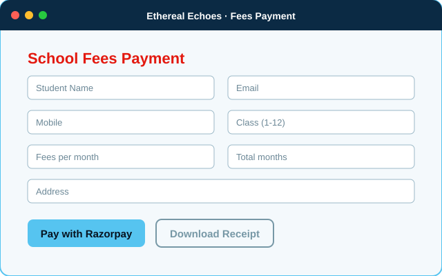
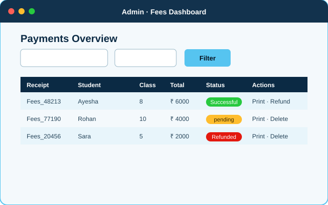
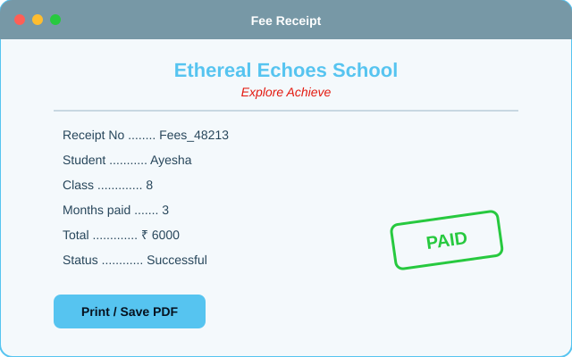
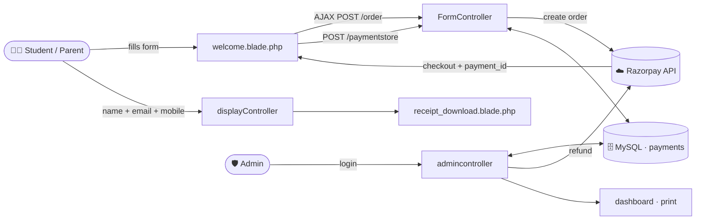
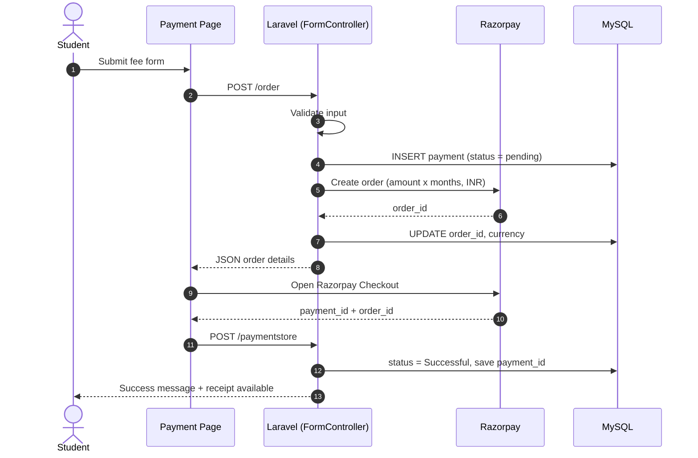
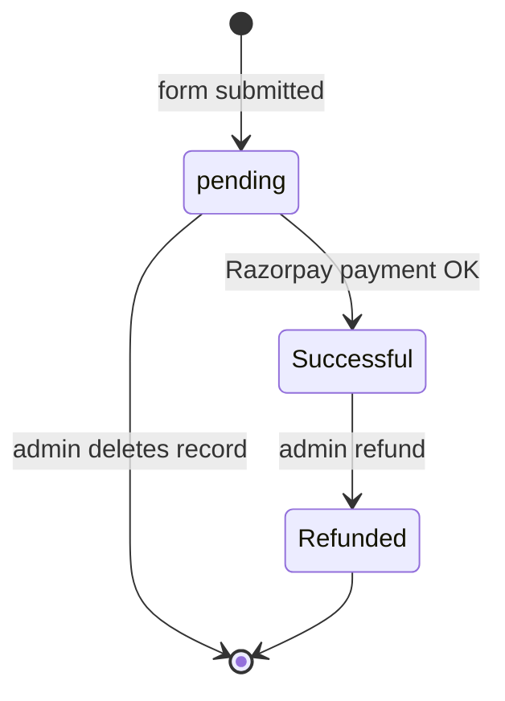
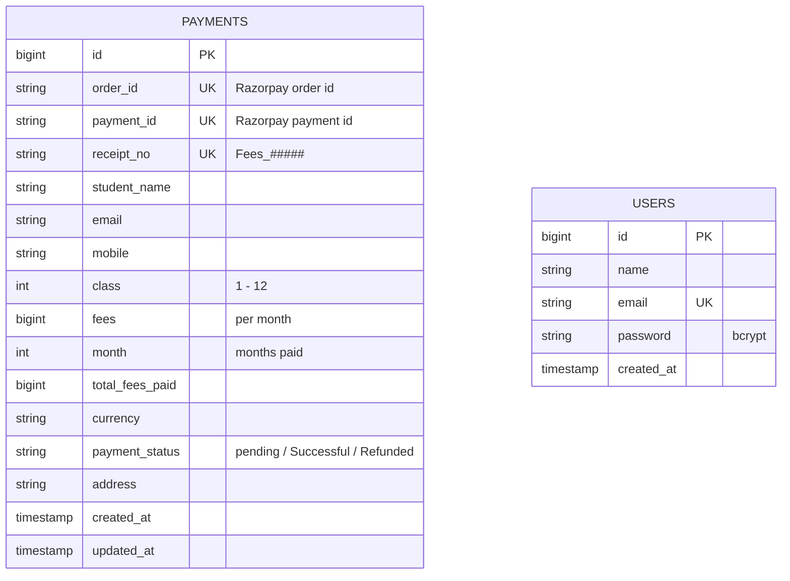

<!-- ===================== HEADER · Developed by Syed Muhammad Tayyab ===================== -->
<div align="center">


<br/>

<a href="https://github.com/Syed-Muhammad-Tayyab/School-Fee-Management-System">
  
</a>

<br/><br/>


<br/>

[**✨ Features**](#-features) •
[**📸 Gallery**](#-gallery) •
[**🧰 Tech Stack**](#-tech-stack) •
[**🚀 Getting Started**](#-getting-started) •
[**🗺️ Roadmap**](#%EF%B8%8F-roadmap) •
[**🤝 Contributing**](#-contributing)

</div>

---

## 📑 Table of Contents

<details open>
<summary><b>Click to expand / collapse</b></summary>

1. [About the Project](#-about-the-project)
2. [Features](#-features)
3. [Gallery](#-gallery)
4. [Tech Stack](#-tech-stack)
5. [Architecture & Diagrams](#-architecture--diagrams)
6. [Project Structure](#-project-structure)
7. [Routes & API Reference](#-routes--api-reference)
8. [Database Schema](#-database-schema)
9. [Colour Palette](#-colour-palette)
10. [How It Works](#-how-it-works)
11. [Getting Started](#-getting-started)
12. [Environment Variables](#-environment-variables)
13. [Deployment](#-deployment)
14. [Security Notes](#-security-notes)
15. [Roadmap](#%EF%B8%8F-roadmap)
16. [FAQ](#-faq)
17. [Contributing](#-contributing)
18. [License & Credits](#-license--credits)
19. [Developer](#-developer)

</details>

---

## 🎓 About the Project

<table>
<tr>
<td width="38%" align="center">

</td>
<td>

**School Fee Management System** is a complete fee-collection portal for educational institutions, built on **Laravel 11**. Parents and students pay monthly fees online through **Razorpay**, then instantly download a printable receipt, while school administrators get a secure dashboard to **search, filter, print, delete and refund** every transaction.

The demo institution is the fictional **Ethereal Echoes School** — *"Explore · Achieve"*.

> 💡 **One portal. Zero queues at the fee counter.**

</td>
</tr>
</table>

---

## ✨ Features

| | Feature | Description |
|:-:|---|---|
| 💳 | **Online Fee Payment** | Pay 1–6 months of fees at once through the Razorpay checkout (UPI, cards, net-banking, wallets) |
| 🧾 | **Instant Receipts** | Look up a receipt by name + email + mobile and download / print it as a clean HTML-to-PDF page |
| 🔐 | **Secure Admin Panel** | Session-based login protected by Laravel `auth` middleware — dashboard routes are not reachable without it |
| 📊 | **Payments Dashboard** | See every transaction newest-first, with status badges (`pending`, `Successful`, `Refunded`) |
| 🔎 | **Smart Filters** | Filter by **date**, by **class (1–12)** or by **both** — results load via AJAX without a page reload |
| 💸 | **One-click Refunds** | Refund through the Razorpay API; the system checks if a payment is already refunded before acting |
| 🖨️ | **Admin Print View** | Print any record from the dashboard on a dedicated print layout |
| 🗑️ | **Record Management** | Delete wrong / test entries straight from the dashboard |
| ✅ | **Server-side Validation** | Name, email, 10-digit mobile, class 1–12 and fee range (2000–9000) are validated on the backend |
| 📱 | **Responsive UI** | Bootstrap 5 layout that works on phones, tablets and desktops |
| 🧪 | **Seeded Admin** | `signupseeder` creates the first admin user in one command |

---

## 📸 Gallery

<div align="center">

| Fee Payment | Admin Dashboard | Receipt |
|:-:|:-:|:-:|
|  |  |  |

<sub>Illustrative previews generated from the real page structure. Drop your own screenshots into <code>docs/assets/</code> and swap the paths above.</sub>

</div>

---

## 🧰 Tech Stack

<div align="center">

| Layer | Technology | Purpose |
|:--|:--|:--|
| 🖥️ **Backend** |   | MVC framework, routing, Eloquent ORM, auth |
| 🗄️ **Database** |   | Stores payments and admin users |
| 💳 **Payments** |  | Orders, checkout, refunds |
| 🎨 **Frontend** |    | Responsive UI and AJAX calls |
| ⚙️ **Tooling** |    | Assets, code style, tests |

</div>

---

## 🧩 Architecture & Diagrams

### System architecture



### Payment sequence



### Payment status lifecycle



---

## 📂 Project Structure

```text
📦 School-Fee-Management-System
├── 📁 .github/                    ⚙️ CI workflow, issue & PR templates
├── 📁 app/
│   ├── 📁 Http/Controllers/
│   │   ├── 📄 FormController.php        💳 create order + store payment
│   │   ├── 📄 displayController.php     🧾 receipt lookup & download
│   │   ├── 📄 admincontroller.php       🛡️ login, dashboard, filter, print, refund, delete
│   │   └── 📄 Controller.php
│   ├── 📁 Models/
│   │   ├── 📄 payment.php               🗃️ payments model
│   │   └── 📄 User.php                  👤 admin user
│   └── 📁 Providers/AppServiceProvider.php
├── 📁 bootstrap/                  🚀 app bootstrap & providers
├── 📁 config/                     🔧 app, auth, database, mail, session …
├── 📁 database/
│   ├── 📁 migrations/             🧱 users, cache, jobs, payments
│   ├── 📁 seeders/                🌱 DatabaseSeeder, signupseeder (admin)
│   └── 📁 factories/UserFactory.php
├── 📁 docs/assets/                🖼️ banner, footer, previews, logo
├── 📁 public/
│   ├── 📁 Bootstrap/              🎨 local Bootstrap css + js
│   ├── 📁 js/jquery-3.7.1.min.js
│   ├── 📁 logo/logo-color.png     🏫 school logo
│   └── 📄 index.php               🚪 front controller
├── 📁 resources/
│   ├── 📁 views/
│   │   ├── 📄 welcome.blade.php         🏠 payment page + receipt modal
│   │   ├── 📄 receipt_download.blade.php 🧾 student receipt
│   │   └── 📁 admin/ (signin · dashboard · print)
│   ├── 📁 css/app.css
│   └── 📁 js/ (app.js · bootstrap.js)
├── 📁 routes/ (web.php · console.php)
├── 📁 storage/                    📦 logs, cache, sessions
├── 📁 tests/ (Feature · Unit)     🧪 PHPUnit
├── 📄 .env.example                🔑 environment template
├── 📄 composer.json · package.json · vite.config.js
├── 📄 CONTRIBUTING.md · CODE_OF_CONDUCT.md · SECURITY.md
├── 📄 LICENSE                     📜 MIT
└── 📄 README.md                   📖 you are here
```

---

## 🛣️ Routes & API Reference

### 🌐 Public

| Method | Endpoint | Controller@method | Description |
|:-:|---|---|---|
| `GET` | `/` | closure → `welcome` | Fee payment page |
| `POST` | `/order` | `FormController@order` | Validate form, save record, create Razorpay order (returns JSON) |
| `POST` | `/paymentstore` | `FormController@paymentstore` | Mark payment `Successful` and save `payment_id` |
| `POST` | `/receipt` | `displayController@receipt` | Find a record by name + email + mobile (JSON) |
| `GET` | `/receipt_download` | `displayController@receipt_download` | Render the printable receipt |

### 🛡️ Admin (`/admin`)

| Method | Endpoint | Auth | Description |
|:-:|---|:-:|---|
| `GET` | `/admin/login` | ❌ | Login page |
| `POST` | `/admin/signin` | ❌ | Authenticate (JSON response) |
| `GET` | `/admin/signout` | ❌ | Log out and redirect |
| `GET` | `/admin/dashboard` | ✅ | Dashboard view |
| `GET` | `/admin/allrecord` | ✅ | All payments, newest first (JSON) |
| `POST` | `/admin/specificrecord` | ✅ | Filter by `selectdate` and/or `selectclass` |
| `GET` | `/admin/print/{id}` | ✅ | Print layout for one record |
| `GET` | `/admin/refund/{id}` | ✅ | Refund via Razorpay and set status `Refunded` |
| `DELETE` | `/admin/delete/{id}` | ✅ | Delete a record |

<details>
<summary><b>📥 Example: <code>POST /order</code></b></summary>

```json
// request (form fields)
{
  "student_name": "Ayesha",
  "email": "ayesha@example.com",
  "mobile": "9876543210",
  "grade": 8,
  "fees": 2000,
  "month": 3,
  "address": "Islamabad"
}

// response
{
  "status": "success",
  "order_id": "order_XXXXXXXXXXXXXX",
  "amount": 200000,
  "student_name": "Ayesha",
  "email": "ayesha@example.com",
  "mobile": "9876543210"
}
```

**Validation rules:** `student_name` letters only · `email` valid · `mobile` exactly 10 digits · `grade` 1–12 · `fees` 2000–9000 · `month` required · `address` required.
</details>

---

## 🗄️ Database Schema



---

## 🎨 Colour Palette

Derived from the **Ethereal Echoes School** logo.

| Swatch | Name | Hex | Used for |
|:-:|---|:-:|---|
|  | Sky Echo | `#56C4F0` | Brand, buttons, highlights |
|  | Scholar Slate | `#7798A6` | Secondary UI, icons |
|  | Achieve Red | `#E3190F` | Headings, tagline, alerts |
|  | Deep Navy | `#0B2A44` | Banners, table headers |
|  | Mist | `#F4F9FC` | Backgrounds |

---

## 🔍 How It Works

<details>
<summary><b>1️⃣ Paying fees</b></summary>

1. The student opens `/` and fills in name, email, mobile, class, monthly fee, number of months and address.
2. `FormController@order` validates the data, saves a **pending** record with a random `Fees_#####` receipt number and creates a Razorpay order for `fees × months` (converted to paise).
3. The Razorpay Checkout opens in the browser. After a successful payment, the page posts `razorpay_order_id` and `razorpay_payment_id` to `/paymentstore`.
4. The record is updated to **Successful** and the student sees a success message.
</details>

<details>
<summary><b>2️⃣ Downloading a receipt</b></summary>

1. Click **Download Receipt** and enter the same name, email and mobile used at payment time.
2. `displayController@receipt` validates and returns the matching record.
3. The page opens `receipt_download` with the data and the student can print / save it as PDF.
</details>

<details>
<summary><b>3️⃣ Admin workflow</b></summary>

1. Log in at `/admin/login`.
2. The dashboard loads all payments through AJAX; use the date and class filters to narrow down.
3. **Print** opens a print layout, **Refund** calls Razorpay then flips the status to `Refunded`, **Delete** removes the row.
</details>

---

## 🚀 Getting Started

### ✅ Prerequisites

- PHP **8.2+** with `mbstring`, `openssl`, `pdo_mysql`
- [Composer](https://getcomposer.org/) 2
- MySQL **8.0+** (WAMP / XAMPP / Laragon all work)
- Node.js 18+ *(only if you want to run Vite)*
- A [Razorpay](https://razorpay.com/) account (test keys are enough)

### 📥 Installation

```bash
# 1. Clone
git clone https://github.com/Syed-Muhammad-Tayyab/School-Fee-Management-System.git
cd School-Fee-Management-System

# 2. Install PHP dependencies
composer install

# 3. Environment file + app key
cp .env.example .env
php artisan key:generate
```

### 🗃️ Database

Create a MySQL database named `schoolfeesportal`, then edit `.env`:

```env
DB_CONNECTION=mysql
DB_HOST=127.0.0.1
DB_PORT=3306
DB_DATABASE=schoolfeesportal
DB_USERNAME=root
DB_PASSWORD=

RAZORPAY_KEY_ID=rzp_test_xxxxxxxxxxxx
RAZORPAY_KEY_SECRET=xxxxxxxxxxxxxxxxxxxxxxxx
```

```bash
# 4. Create tables and the admin account
php artisan migrate
php artisan db:seed --class=signupseeder

# 5. (Optional) frontend tooling
npm install && npm run build

# 6. Run
php artisan serve
```

| 🔗 Page | URL |
|---|---|
| Fee portal | <http://localhost:8000> |
| Admin login | <http://localhost:8000/admin/login> |

### 🔑 Demo admin credentials

| Field | Value |
|---|---|
| 📧 Email | `admin@ethereal.edu.in` |
| 🔒 Password | `admin@12345` |

> ⚠️ **Change this password immediately** on any non-local environment.

### 🧪 Run the tests

```bash
php artisan test
./vendor/bin/pint        # code style
```

---

## ⚙️ Environment Variables

| Variable | Required | Description |
|---|:-:|---|
| `APP_KEY` | ✅ | Generated by `php artisan key:generate` |
| `APP_URL` | ✅ | Base URL of the app |
| `DB_CONNECTION` | ✅ | `mysql` (recommended) or `sqlite` |
| `DB_DATABASE` / `DB_USERNAME` / `DB_PASSWORD` | ✅ | MySQL credentials |
| `RAZORPAY_KEY_ID` | ✅ | Razorpay public key |
| `RAZORPAY_KEY_SECRET` | ✅ | Razorpay secret key — never commit it |
| `APP_DEBUG` | — | Set to `false` in production |

---

## ☁️ Deployment

<details>
<summary><b>Shared hosting / cPanel</b></summary>

1. Upload the project and point the domain's document root to the `public/` folder.
2. Set `APP_ENV=production`, `APP_DEBUG=false` and live Razorpay keys in `.env`.
3. Run `composer install --no-dev --optimize-autoloader` and `php artisan migrate --force`.
4. Run `php artisan config:cache && php artisan route:cache && php artisan view:cache`.
</details>

<details>
<summary><b>VPS (Nginx + PHP-FPM)</b></summary>

1. Install PHP 8.2, Composer, MySQL and Nginx.
2. Point the Nginx `root` to `/var/www/School-Fee-Management-System/public` and route everything through `index.php`.
3. Set directory permissions: `chown -R www-data storage bootstrap/cache`.
4. Enable HTTPS (Let's Encrypt) — Razorpay Checkout requires it in live mode.
</details>

---

## 🛡️ Security Notes

Good practices already in place: bcrypt-hashed admin passwords, Laravel `auth` middleware on every admin route, CSRF protection on form posts, server-side validation, unique constraints on order/payment ids.

Hardening ideas before going live:

- 🔏 Verify the **Razorpay payment signature** server-side in `paymentstore` before marking a payment `Successful`.
- 🔑 Read keys through `config()` instead of `env()` so `php artisan config:cache` keeps working.
- 🚫 Receipt data is passed in the query string — move to a signed, server-side lookup by `receipt_no`.
- 🗝️ Change the seeded admin password and consider rate-limiting `/admin/signin`.
- 🧾 Add a role/permission layer if more than one admin will use the panel.

---

## 🗺️ Roadmap

- [x] Online fee payment with Razorpay
- [x] Receipt lookup and printable download
- [x] Admin login and dashboard
- [x] Date / class filters with AJAX
- [x] Razorpay refunds
- [ ] Razorpay signature verification & webhooks
- [ ] Email / SMS receipt after payment
- [ ] PDF generation on the server (DomPDF)
- [ ] Student accounts with payment history
- [ ] Late-fee, discount and scholarship rules
- [ ] Export to Excel / CSV and monthly reports
- [ ] Multi-currency and multi-admin roles
- [ ] Dockerfile and docker-compose
- [ ] Feature tests for the payment flow

---

## ❓ FAQ

<details>
<summary><b>Can I use it without a real Razorpay account?</b></summary>
Yes — create a free Razorpay account and use the <b>test mode</b> keys. No real money is charged.
</details>

<details>
<summary><b>Which currency is used?</b></summary>
Orders are created in <b>INR</b>. Change the <code>currency</code> value in <code>FormController@order</code> to support others.
</details>

<details>
<summary><b>Why can't I log in as admin?</b></summary>
Make sure you ran <code>php artisan db:seed --class=signupseeder</code>, then use the demo credentials above.
</details>

<details>
<summary><b>Can I rename the school?</b></summary>
Yes. Update the titles in <code>resources/views/*.blade.php</code> and replace <code>public/logo/logo-color.png</code>.
</details>

---

## 🤝 Contributing

Contributions are what make open source great!

1. 🍴 Fork the project
2. 🌿 Create a branch — `git checkout -b feat/awesome-feature`
3. 💾 Commit — `git commit -m "feat: add awesome feature"`
4. 📤 Push — `git push origin feat/awesome-feature`
5. 🔁 Open a Pull Request

See [CONTRIBUTING.md](CONTRIBUTING.md) and [CODE_OF_CONDUCT.md](CODE_OF_CONDUCT.md).

---

## 📜 License & Credits

Released under the **MIT License** — see [LICENSE](LICENSE).

- 🏗️ Original project concept & base code: **[Subodh Dhyani](https://github.com/subodhdhyani/School-Fee-Management-System)** (MIT)
- 🎨 Repository redesign, documentation and README: **Syed Muhammad Tayyab**
- 🙏 Built with [Laravel](https://laravel.com), [Razorpay](https://razorpay.com), [Bootstrap](https://getbootstrap.com), [jQuery](https://jquery.com)

> **Disclaimer:** "Ethereal Echoes School", its name and logo are hypothetical and used for demonstration only. Any resemblance to real institutions is coincidental.

---

## 👨‍💻 Developer

<div align="center">


**BSCS Student · Information Security · Full-Stack Developer · Islamabad, Pakistan**

[](https://github.com/Syed-Muhammad-Tayyab)

⭐ **If this project helped you, please give it a star!** ⭐

<br/>

<!-- ===================== FOOTER · Developed by Syed Muhammad Tayyab ===================== -->


</div>
